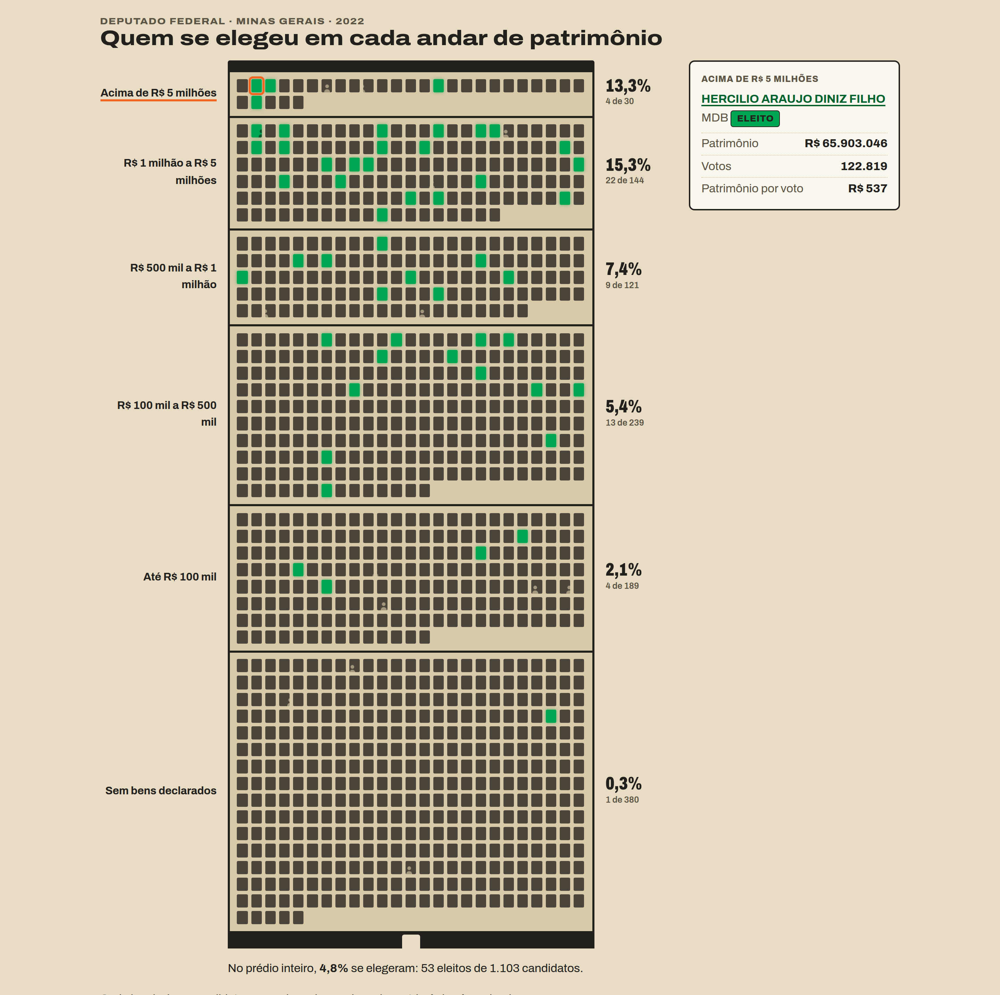
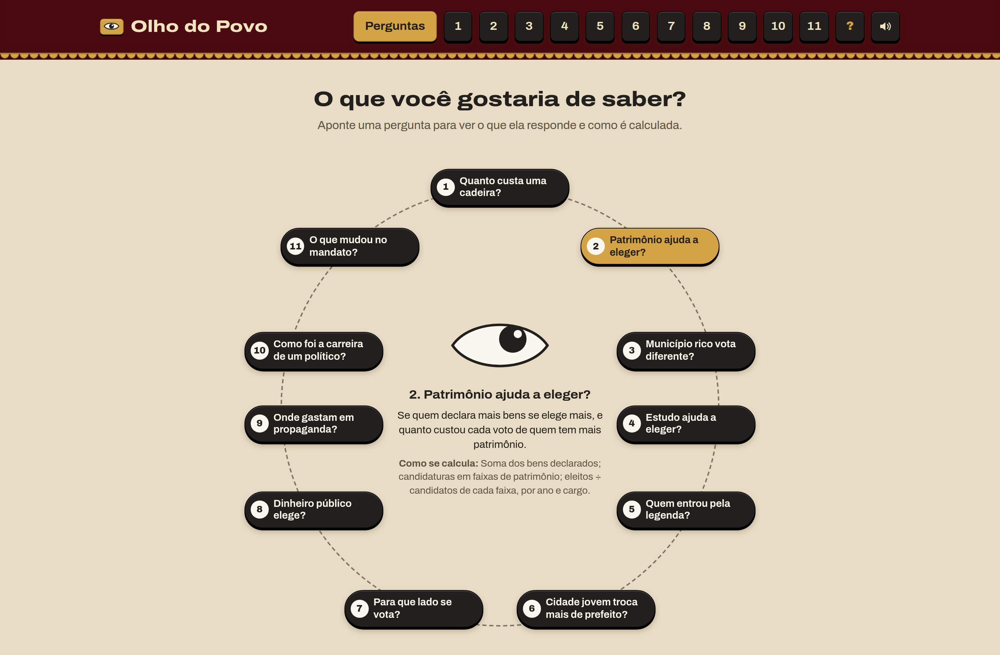
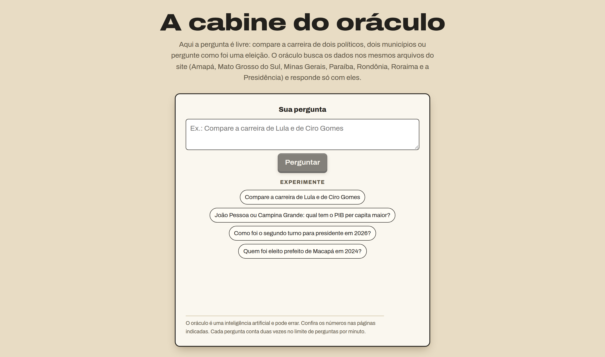

# Eleições brasileiras: custo, financiamento, perfil e desempenho

Projeto da disciplina de Bancos de Dados Relacionais.
Reúne dados abertos do TSE sobre candidaturas, votação, patrimônio e prestação de
contas de 1994 a 2026, cruzados com indicadores municipais do IBGE, do Atlas do
Desenvolvimento Humano e do Atlas da Violência e com uma classificação ideológica dos
partidos, num banco PostgreSQL que responde a onze perguntas sobre o Brasil inteiro:
as 27 UFs, os 5.571 municípios e a Presidência. As carreiras completas (a linha do
tempo de cada político, de 1994 a 2026) são de quem já se elegeu ao menos uma vez e de
todos os candidatos a presidente; os demais candidatos aparecem, com nome, nas
eleições de que participaram e em todos os totais.

Lucas Vilarinho, Raimundo Nonato, Matheus Carneiro e Gabriel Araújo.

## O site: Olho do Povo

Os dados eleitorais são públicos, mas chegam em milhões de linhas de planilha que
quase ninguém consegue ler. O Olho do Povo transforma cada resposta do banco num
desenho que se entende de relance: um prédio, um mapa, copos que enchem, uma linha do
tempo. Cada pergunta tem uma página, e um clique leva do desenho ao número exato e
ao candidato por trás dele.



*Pergunta 2: cada andar é uma faixa de patrimônio declarado, cada janela um candidato; as acesas são os eleitos.*



*A página inicial: cada pergunta em volta do olho; apontar uma mostra o que ela responde e como é calculada.*

## A IA: o oráculo

Mesmo com o desenho, nem todo mundo sabe o que procurar nele. Por isso cada página tem
um oráculo, o olho no canto da tela, a quem se pergunta em português o que os números
querem dizer. A IA lê; não calcula: todos os números saem do banco, e ela só os explica.

- **O que ela vê.** A página monta um *retrato* do que está na tela (o recorte
  escolhido e os números exibidos) e o envia junto com o método da pergunta, que diz
  como cada número foi calculado e o que ele não prova. A IA não tem acesso ao banco
  nem à internet. As regras mandam usar só os números do retrato, não fazer contas
  novas, ser neutra (sem avaliar candidatos, partidos ou ideologias) e dizer quando
  falta algo para responder em vez de forçar uma conclusão.
- **Mudar a página pela pergunta.** Antes da IA, uma regra fixa no navegador lê a
  pergunta: se ela pede outro estado, ano ou cargo ("e em Roraima?"), a página muda
  para esse recorte e avisa, com um botão de desfazer. Assim a resposta fala do que
  está na tela.
- **Onde ela roda.** Uma função na Cloudflare (`oraculo/`) recebe o retrato e pergunta
  a um modelo aberto, o Gemma, no Workers AI, dentro da cota gratuita. Não há chave de
  API no site; a função só aceita pedidos do próprio site e limita cada visitante a
  6 perguntas por minuto. A resposta chega aos poucos, enquanto é escrita.
- **A cabine do oráculo.** Na página `cabine.html` a pergunta é livre ("compare a
  carreira de Lula e de Ciro Gomes"). Aqui são dois passos: a IA primeiro transforma a
  pergunta num pedido de dados; o site busca esses dados nos mesmos arquivos das
  páginas e só então a IA responde, com cartões que levam às páginas de onde os
  números vieram.
- **Os limites.** Toda resposta traz o aviso de que a IA pode errar e aponta onde
  conferir. Quando a cota do dia acaba ou o serviço cai, o oráculo avisa que está
  descansando; o resto do site continua funcionando sem ele.



*A cabine do oráculo: a pergunta é livre, e a resposta usa só os dados do site.*

## Estrutura

```
.
├── crawler/     baixa das fontes só os arquivos que as perguntas usam (python -m crawler)
├── banco/       esquema, carga, validação e as 18 consultas das perguntas
├── scripts/     geração e restauração do dump do banco
├── site/        Olho do Povo, o site estático das onze perguntas (GitHub Pages)
├── oraculo/     o oráculo: a função na Cloudflare que leva o retrato da página à IA
└── docs/        página do modelo (D.E.R. e tabelas) e figuras do D.E.R.
```

## Como usar

Para só montar o banco e rodar as consultas, siga o [TUTORIAL.md](TUTORIAL.md), que
explica passo a passo como baixar o dump da página de Releases e executar cada
consulta. As seções abaixo detalham cada parte.

### Ver o modelo

Abra `docs/modelo/modelo_relacional.html` no navegador. A página tem os três diagramas
do D.E.R. e as 21 tabelas, com o mapeamento entre eles.

### Antes de montar o banco: PostgreSQL e um papel com permissão

Os dois caminhos abaixo precisam do PostgreSQL 16 ou mais recente. No PostgreSQL, quem
acessa o banco é um **papel** (usuário do banco), não o usuário do sistema, e uma
instalação nova só tem o papel administrador `postgres`. No Linux, as conexões locais
exigem um papel com o mesmo nome do seu usuário do sistema. Crie esse papel com
permissão para criar bancos, que é o mínimo necessário:

```bash
sudo apt install postgresql
```

```bash
sudo -u postgres createuser --createdb $USER
```

No Windows e no macOS, o instalador cria o `postgres` com uma senha, e a conexão é pela
rede. Informe-a nas variáveis padrão antes de rodar os scripts:

```bash
export PGHOST=localhost PGUSER=postgres PGPASSWORD=a-senha-escolhida
```

O `restaura_dump.sh` confere tudo isso antes de começar e, se faltar algo, mostra o
comando que resolve.

### Montar o banco a partir do dump

É o caminho rápido: não precisa do crawler nem dos 31 GB de CSV. Requer PostgreSQL 16.
Baixe o `eleicoes.dump` (cerca de 900 MB) da página de Releases do repositório e restaure; leva cerca
de um minuto:

```bash
scripts/restaura_dump.sh eleicoes.dump
```

Para gerar um dump novo depois de refazer a carga: `scripts/gera_dump.sh`.

### Montar o banco do zero

Requer Python 3.10+, PostgreSQL 16 e cerca de 50 GB livres (33 GB de arquivos e 9 GB
de banco). O download é de uns 6 GB.

```bash
cd crawler
python3 -m venv venv && venv/bin/pip install -r requirements.txt
venv/bin/python -m crawler
```

```bash
cd banco
python3 -m venv .venv && .venv/bin/pip install -r requirements.txt
createdb eleicoes
.venv/bin/python carga.py
psql -d eleicoes -f 03_validacao.sql
```

A carga leva cerca de uma hora e grava as 27 UFs; um recorte menor pode ser escolhido
com `--ufs` (veja `banco/README.md`). O que cada etapa gravou e descartou fica na tabela
`carga.log`, e as decisões que os dados reais exigiram estão em `banco/README.md`.

### Responder às perguntas

As consultas ficam em `banco/sql/`, uma por pergunta (ou parte dela). O script abaixo
executa todas com parâmetros fixos e grava o resultado, um print e um CSV de cada uma
em `banco/evidencias/`:

```bash
cd banco && ./evidencias.sh
```

O site em `site/`, o Olho do Povo, mostra as respostas das onze perguntas, cada uma numa
página própria, a partir de arquivos gerados do banco; veja `site/README.md`.

As perguntas sobre ideologia usam três medidas por partido (especialistas,
coligações e votações na Câmara), explicadas em
[`banco/README.md`](banco/README.md#ideologia-dos-partidos-três-medidas).

## Fontes

- **TSE**, Portal de Dados Abertos: candidaturas, bens, vagas, votação, prestação de
  contas e comparecimento.
- **IBGE**, APIs SIDRA e de Localidades: PIB, população, Censos 2010 e 2022 (idade,
  instrução e saneamento), empregos formais (CEMPRE), desocupação e informalidade
  (PNAD Contínua) e territórios.
- **Atlas da Violência** (Ipea): taxa de homicídios por município.
- **Atlas do Desenvolvimento Humano** (PNUD, Ipea e FJP), pela API do Ipeadata: IDHM,
  escolaridade e envelhecimento.
- **Harvard Dataverse**, doi:10.7910/DVN/MFIXKW: classificação ideológica dos partidos
  por especialistas (Bolognesi, Codato, Ribeiro e Silva).
- **Painel Análise da Câmara dos Deputados** (dados-camara-dashboard-alpha.vercel.app):
  posição média dos partidos nas votações nominais da Câmara, copiada em
  `banco/fontes/espectro_camara.json`.
